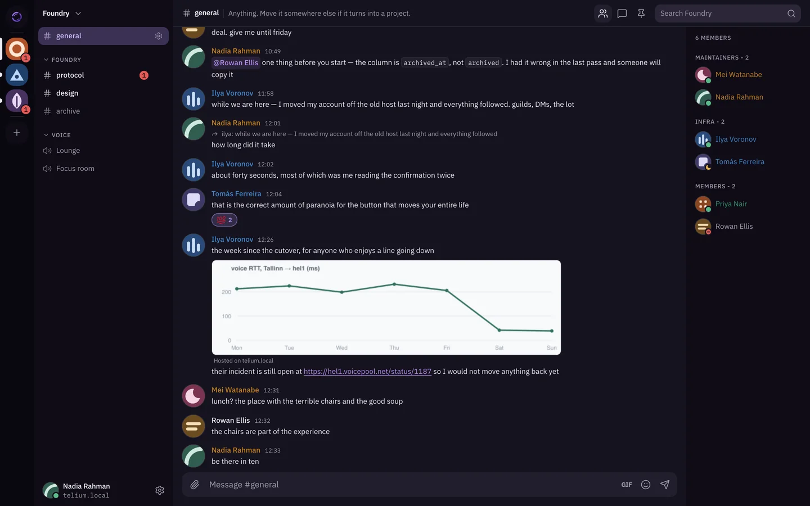

<p align="center">
  <picture>
    <source media="(prefers-color-scheme: dark)" srcset="site/public/brand/telium-lockup-light.svg">
    
  </picture>
</p>

<p align="center">
  <strong>Self-hosted chat with guilds, channels, roles, threads, DMs, voice and video.</strong><br>
  Your account lives on your server. A guild lives on its own server,
  and you can join guilds hosted anywhere.
</p>

<p align="center">
  <a href="https://docs.telium.chat/">Documentation</a> ·
  <a href="https://docs.telium.chat/start/quick-start/">Quick start</a> ·
  <a href="https://docs.telium.chat/self-hosting/install-docker/">Self-hosting</a> ·
  <a href="https://telium.chat/download">Download</a> ·
  <a href="https://github.com/telium-chat/telium/issues">Report an issue</a>
</p>

<p align="center">
  
</p>

> [!WARNING]
> Telium is alpha. Expect breaking changes, and keep backups you have tested — [Stability](https://docs.telium.chat/start/stability/) explains what that means in practice.

## Documentation

The full documentation lives at [docs.telium.chat](https://docs.telium.chat/). The pages people look for most:

|  |  |
|---|---|
| **Try it** | [Quick start](https://docs.telium.chat/start/quick-start/) · [Clients](https://docs.telium.chat/start/clients/) |
| **Self-host** | [Install with Compose](https://docs.telium.chat/self-hosting/install-docker/) · [Install natively](https://docs.telium.chat/self-hosting/install-systemd/) · [Running in production](https://docs.telium.chat/self-hosting/production/) · [Configuration](https://docs.telium.chat/self-hosting/configuration/) · [Upgrading](https://docs.telium.chat/self-hosting/upgrades/) · [Backups](https://docs.telium.chat/self-hosting/backups/) |
| **Voice and video** | [Run an SFU](https://docs.telium.chat/self-hosting/sfu/) |
| **Federation** | [How federation works](https://docs.telium.chat/federation/overview/) · [Account homes and signups](https://docs.telium.chat/federation/onboarding/) · [Moving accounts and guilds](https://docs.telium.chat/federation/migration/) |
| **Build on Telium** | [Architecture](https://docs.telium.chat/start/architecture/) · [Protocol spec](https://docs.telium.chat/reference/protocol/) · [HTTP and gateway API](https://docs.telium.chat/reference/api/) · [Bots](https://docs.telium.chat/features/bots/) · [Repository layout and testing](https://docs.telium.chat/reference/development/) |
| **Security and privacy** | [Threat model](https://docs.telium.chat/security/threat-model/) · [DM encryption](https://docs.telium.chat/security/dm-encryption/) · [Privacy](https://docs.telium.chat/security/privacy/) |
| **Help** | [Getting help](https://docs.telium.chat/start/getting-help/) · [Translating](https://docs.telium.chat/reference/translating/) · [Changelog](CHANGELOG.md) |

## Run it

You need Rust 1.85+ and Bun.

```sh
git clone https://github.com/telium-chat/telium.git
cd telium/server
cargo run -- init     # writes telium.toml
cargo run -- serve    # 127.0.0.1:8448
```

In a second terminal:

```sh
cd telium/web
bun install
bun run dev           # http://localhost:5173
```

Open the client and register — the first account on a fresh server becomes its admin. The [quick start](https://docs.telium.chat/start/quick-start/) has the full walkthrough.

## Contributing

Report bugs on the issue tracker, or in the client under Settings → Help & feedback. Report security issues privately through [SECURITY.md](SECURITY.md). [CONTRIBUTING.md](CONTRIBUTING.md) covers the rest.

[Apache 2.0](LICENSE)
